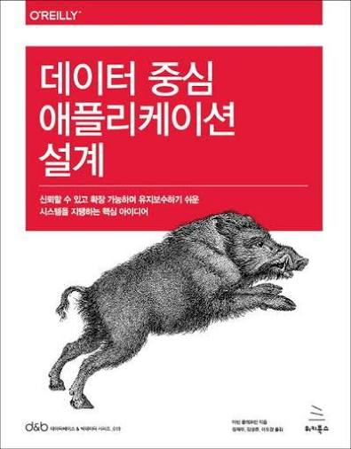

데이터 중심 애플리케이션 설계(DDIA)를 읽고 정리한다.

```text
기술은 우리 사회에서 강력한 힘이다.
데이터, 소프트웨어, 통신은 얼마든지 나쁜 용도로 사용될 수 있다.
즉, 불공정한 권력 구조를 굳히고 인권을 유린하고 기득권을 보호하는 데 쓸 수 있다.

물론 좋은 용도로도 사용 가능하다.
소외된 사람들의 목소리를 듣고 모든 사람을 위한 기회를 만들고 재난을 피하는 데 사용될 수 있다.
선을 위해 일하는 엔지니어가 되자.
```



